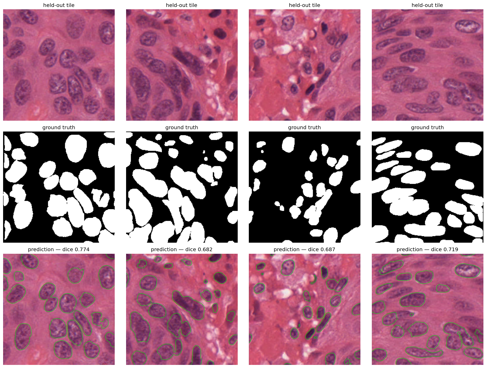
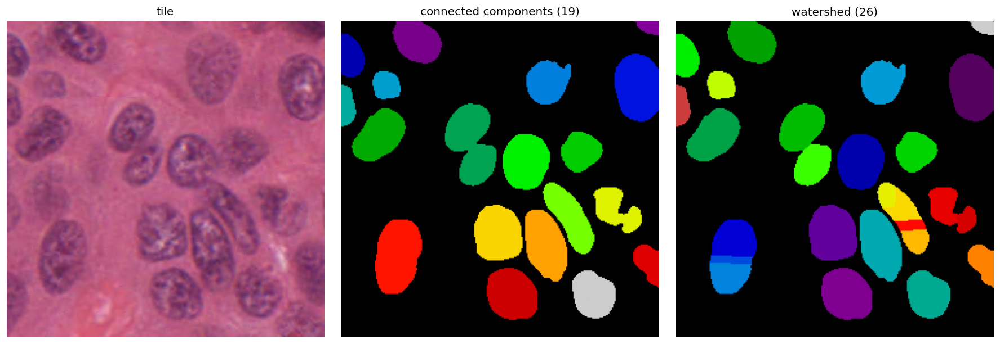

# Nuclei Segmentation & Quantification in H&E Histopathology

Semantic segmentation and instance-level counting of cell nuclei in H&E-stained
tissue images, benchmarked on the MoNuSeg (MICCAI 2018) dataset.

Nucleus count, size and density are diagnostic parameters in digital pathology —
tumour tissue typically shows enlarged, irregular, densely packed nuclei. A
whole-slide image is on the order of 50,000 × 50,000 pixels, so counting by hand
is impractical and the measurement is usually estimated by eye. This project
implements the standard pipeline for automating it: a U-Net for pixel-level
segmentation, followed by distance-transform watershed to separate touching
nuclei into countable instances.



*Green contours are model predictions on slides never seen during training.
Per-tile Dice shown above each panel.*

## Results

| Metric | Value |
|---|---|
| Dice (validation) | **0.762** |
| IoU, nuclei only (validation) | **0.651** |
| Nucleus count error — connected components | 26.7% mean absolute, per tile |
| Nucleus count error — after watershed | **10.0%** mean absolute, per tile |
| Best epoch | 16 of 28 (early stopped, patience 12) |
| Training time | ~5 min on a Colab T4 |

Validation is 6 slides held out at the **slide level**, never seen in training.

These are the numbers from a clean restart-and-run-all of the notebook, not from
an accumulated session. Across three independent runs validation Dice came out at
0.766, 0.763 and 0.762, so ~0.76 is the model's real level rather than one lucky
run.

For context, published vanilla U-Net results on MoNuSeg report Dice in the
0.73–0.76 range, with nucleus-specific architectures such as HoVer-Net reaching
~0.83. This implementation lands at the upper end of the plain U-Net band, which
is the expected result for a standard encoder–decoder without task-specific
architectural modifications.

## The problem this solves

A binary mask says *nucleus or not nucleus*. It cannot say *how many*. Where two
nuclei touch, the model's probability map dips at the shared boundary — it is
genuinely less confident there — but thresholding at 0.5 discards that signal and
the two nuclei fuse into one connected region. Counting connected components then
undercounts.

This is also why Dice alone is a misleading metric here: a merged pair covers
almost exactly the right pixels, so Dice barely moves, while object-level counting
is wrong. Instance separation is a separate step, and it is measured separately
below.

## Method

**Data.** MoNuSeg 2018 training set: 30 H&E slides at 1000×1000, 40× magnification,
drawn from TCGA across seven organs (breast, liver, kidney, prostate, bladder,
colon, stomach). Annotations are per-nucleus polygon outlines stored as Aperio
ImageScope XML, 0.252 µm/pixel.

**Mask construction.** Each `Region` element in the XML is one nucleus, stored as a
vertex list (median 253 vertices — dense freehand tracing). Polygons are rasterised
twice: once filled with 1 for a binary semantic mask, and once filled with an
incrementing integer for an instance mask where every nucleus carries its own id.

Masks were verified two ways — visually, by overlaying contours on the source tile,
and physically, by checking mean nucleus area (888.8 px at 0.252 µm/px → ~56 µm²,
an equivalent diameter of ~8.5 µm, which is the correct biological scale).

**Tiling.** 1000 is not divisible by 256. A stride of 256 gives 3 tiles per axis
covering 768 px and silently discards the remaining 232 px of every slide — 23% of
the data. Instead tiles are taken at offsets `[0, 248, 496, 744]` on each axis:
full coverage with 8 px of overlap between neighbours. 16 tiles per slide, 480
total, 0 empty, mean nucleus pixel fraction 0.246.

**Splitting.** The train/validation split is **by slide, not by tile**. Tiles from
one slide share a patient, a staining batch and a scanner, and neighbouring tiles
literally share pixels. A random tile-level split would place near-duplicates on
both sides of the split and inflate the validation score. 24 slides train /
6 validation (384 / 96 tiles), seeded for reproducibility. Nucleus pixel fraction
is 0.240 train against 0.269 validation, so the split is reasonably balanced.

**Augmentation.** Only the eight exact symmetries — 90° rotations and flips. Nuclei
have no canonical orientation, so these are label-preserving and require no
interpolation. Scaling and elastic deformation were deliberately excluded: nucleus
size is itself a diagnostic property, and interpolation would blur a binary mask
into fractional values. Image and mask are concatenated into one 4-channel tensor
before augmenting, so both receive an identical transform — augmenting them
separately gives each its own random draw and silently mislabels the data.

**Model.** U-Net with an ImageNet-pretrained ResNet50V2 encoder truncated at
`conv4_block6_1_relu`, and a decoder of four upsampling blocks with skip
connections at 256 / 128 / 64 / 32. 9,889,921 parameters.

Two choices worth noting. The encoder is pretrained because 384 training tiles is
far too few to learn general edge and texture filters from scratch; the effect is
visible in epoch 1, which already reaches ~0.68 train Dice against an untrained
floor near 0.46. The encoder is truncated rather than used at full depth because
the deepest ResNet layers encode object-level semantics at 8×8 resolution, which is
of no use for objects ~34 px across; cutting at conv4 keeps the receptive field
matched to nucleus scale and roughly halves the parameter count.

The skip connections are what make boundaries possible at all — by the bottleneck
the grid is 16×16 and exact nucleus edges are gone. The skip from the input
resolution puts them back. The input skip is taken as `encoder.input` rather than
by layer name, because Keras 3 renames the input layer (`input_layer_1`, …) when a
model is built more than once in a session, which breaks a name lookup on re-run.

**Loss.** `BCE + (1 − Dice)`. BCE alone is dominated by the ~75% of pixels that are
background; Dice alone is unstable early in training when predictions are near
random. The sum gives Dice's focus on the foreground region with BCE's gradient
behaviour — the standard pairing for medical segmentation. Dice carries a
`smooth=1.0` term so an empty tile returns 1.0 rather than NaN.

**Training.** Adam at 1e-3, batch size 8, up to 40 epochs. Checkpointing, LR
reduction (×0.5, patience 5) and early stopping (patience 12, best weights
restored) are all keyed to validation Dice, never training loss.

## Instance separation

The U-Net produces a binary mask in which touching nuclei fuse. Watershed recovers
the separation: the distance transform assigns each foreground pixel its distance
to the nearest background pixel, giving one peak per nucleus with a low ridge where
two nuclei meet. Flooding outward from those peaks places the boundary on the ridge.

Measured across 8 validation tiles, this **cuts the counting error from 26.7% to
10.0%**.



*On this tile: 19 objects by connected components, 26 after watershed, against a
ground truth of 28. The fused nuclei in the middle panel are split on the right.*

`min_distance` controls how close two peaks may be before they are merged into one.
It was selected by sweeping across the same 8 validation tiles:

| min_distance | 2 | 3 | 4 | **5** | 7 |
|---|---|---|---|---|---|
| mean abs count error | 93.8% | 32.8% | 15.1% | **10.0%** | 16.9% |

The curve is steep on the left — below 4, single nuclei fragment into pieces and
the error explodes — and shallower on the right, where genuine separations are
gradually lost.

## Known limitations

These are deliberate, documented, and would be the first things to address next.

**Annotation count discrepancy.** Parsing every `Region` across all 30 XML files
yields **16,966** nuclei, where the dataset paper reports 21,623 for the training
set — a 21% gap. This was investigated rather than ignored: per-file counts range
294–1863 with no zero or anomalously small file (so it is not a parse failure on
specific files), there is a single annotation layer with a uniform region attribute
signature (so no element class is being dropped), and the per-file counts match
those of independent mirrors of this archive. The discrepancy therefore lies in the
distributed archive rather than in the parser. All masks are built from the regions
actually present, so the pipeline is internally consistent either way.

**`min_distance` is tuned on validation tiles, and its optimum is unstable.**
Across three independent training runs the sweep minimum landed at 5, then 7, then
5 again:

| run | md = 5 | md = 7 | winner |
|---|---|---|---|
| 1 | 14.7% | 14.9% | 5 |
| 2 | 15.2% | 12.8% | 7 |
| 3 | 10.0% | 16.9% | 5 |

Eight tiles is not enough to determine this parameter sharply. 5 is kept as the
default because it wins two runs of three, but the honest reading of the headline
figure is "roughly 10–15% count error", not a precise optimum. It is also not a
clean held-out measurement, since the same tiles select the value and report it.

**Overfitting is data-limited, not architectural.** Validation Dice peaked at epoch
16 and did not improve across 12 further epochs, while training Dice continued to
0.843. Two learning-rate reductions failed to recover it. With 24 training slides
the model had extracted what the data supports; more epochs or a larger model would
not help. Stain normalisation, stain augmentation, or additional slides would.

**Watershed introduces some false splits.** It corrects merged nuclei but
occasionally divides a single elongated nucleus. Net count error improves sharply,
but the operation is not free, and this is visible in the figure above.

**Weakest on low-contrast elongated nuclei.** Faint spindle-shaped nuclei are the
most common miss. Errors overall are concentrated at boundaries rather than in
detection — most nuclei are found, with contours sitting slightly outside the true
edges — which means Dice understates object-level recall.

**No stain normalisation.** Slides come from 18 institutes with different staining
protocols and scanners, producing visible colour variation. Macenko or Vahadane
normalisation would be the next addition and is the most likely source of a real
improvement.

**Seeded, but not bit-reproducible.** `tf.keras.utils.set_random_seed(0)` fixes the
Python, NumPy and TensorFlow seeds, so the data split and tiling reproduce exactly —
16,966 nuclei, 480 tiles, the same 24/6 slide split every run. GPU kernels remain
non-deterministic without `enable_op_determinism()`, so training metrics vary by a
few tenths of a percent between runs (0.766 / 0.763 / 0.762 across three).

## Repository contents

```
nuclei_segmentation.ipynb   full pipeline, runs top to bottom in Colab
predictions.png             model output on held-out slides
watershed.png               connected components vs watershed
README.md                   this file
```

Trained weights (`nuclei_unet.keras`, 119 MB) are **not** included — the file
exceeds GitHub's 100 MB limit. It can be regenerated by running the notebook,
which takes about 5 minutes on a T4.

## Running it

Open `nuclei_segmentation.ipynb` in Google Colab, set the runtime to GPU
(Runtime → Change runtime type → T4), and run top to bottom. The notebook
downloads the dataset itself; no manual setup is required.

Built with TensorFlow 2.21 / Keras 3, scikit-image, scipy, Pillow, NumPy.

## Data and citation

MoNuSeg 2018 data is released under CC BY-NC-SA 4.0 (non-commercial).

> N. Kumar, R. Verma, S. Sharma, S. Bhargava, A. Vahadane, A. Sethi.
> "A Dataset and a Technique for Generalized Nuclear Segmentation for
> Computational Pathology." *IEEE Transactions on Medical Imaging*,
> 36(7):1550–1560, 2017.

Dataset: https://monuseg.grand-challenge.org/Data/

---

Anurag Prakash · IIT (BHU) Varanasi

This is a reimplementation of a published benchmark for learning purposes, not
novel research. Built with AI assistance.
